# BUILD.md — Build a test machine: Ubuntu Server + Windows 11 on one network

You need a laptop and an internet connection, nothing else.
**What you get:** two virtual machines (small "computers inside your computer"). They share a private network, both reach the internet, both can ping each other, and both have a saved clean state you can go back to if anything breaks.

How to read this: every step is one action. After most steps there is a **Check** (how you know it worked) and a **Why** (why this option and not another).
The step-by-step screenshots used in this document are in [screenshots/](screenshots/) (the six required proof files are in [evidence/](evidence/)). Each picture is shown under the step it belongs to; its file name is written in the step, and the full list is at the end of this document.

Words used: **host** = your real laptop. **Guest** = a virtual machine. **ISO** = a file that works like an installation disc.

---

## Part A. Check your laptop

1. Press Ctrl+Shift+Esc to open Task Manager, click **Performance**, then **CPU**.
2. Look at the bottom right for **Virtualization**. It must say **Enabled**.
   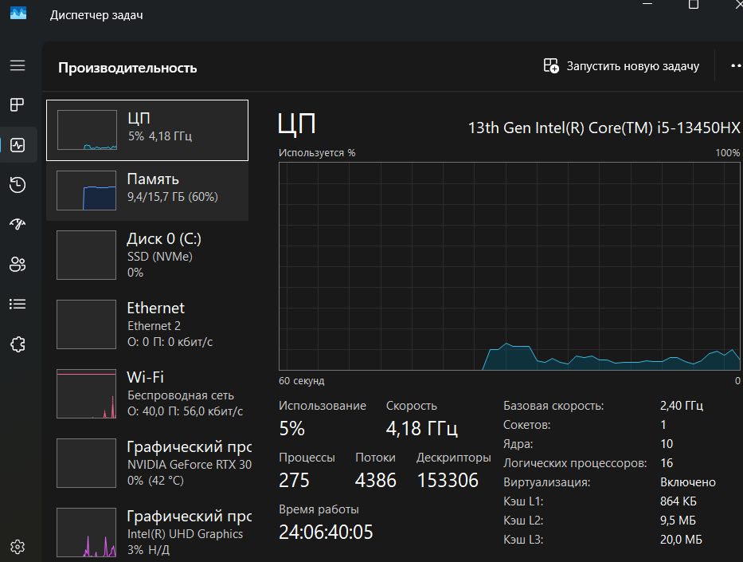
   **Check:** "Enabled". If it says Disabled, restart the laptop, open the BIOS/UEFI settings (usually F2, F10 or Del at startup) and turn on **Intel VT-x** or **AMD-V / SVM**. Without it the machines will not start.
3. Click **Memory** and write down total RAM: [X] GB. Open File Explorer → This PC and write down free disk space: [free] GB.
   **Why:** the sizes of the virtual machines depend on these two numbers.

### How much to give the guests

| | RAM | Processors | Disk (maximum) |
|---|---|---|---|
| Ubuntu Server | 2 GB | 2 | 25 GB |
| Windows 11 | 4 GB (Microsoft minimum) | 2 | 64 GB (Microsoft minimum) |
| Both together | 6 GB | 4 | 89 GB |

**Rule:** after giving 6 GB to the guests, the laptop must keep at least 6 GB. For my laptop: 16 GB total − 6 GB = 10 GB left. If you have less than 12 GB RAM, do not run both guests at the same time. Free disk space must be more than 89 GB (disks grow up to their maximum).

---

## Part B. Download everything

1. Open https://www.virtualbox.org/wiki/Downloads and download **VirtualBox 7.x platform packages** for Windows hosts.
   **Why VirtualBox:** it is free, works the same on Windows, macOS and Linux, and (version 7+) supports the security chip Windows 11 demands.
   **Licence:** VirtualBox itself is free (GPLv2). **Do not download the "Extension Pack"**: it is free only for personal or educational use, and an office would need to buy a licence.
2. Run the installer and keep all default options.
3. Open https://ubuntu.com/download/server and download **Ubuntu Server 24.04 LTS**.
   **Why Server and LTS:** no desktop, so it needs little RAM; LTS gets security updates for five years.
4. Open https://www.microsoft.com/en-us/evalcenter/evaluate-windows-11-enterprise and download the **ISO, 64-bit, English**.
   **Why the evaluation:** it is free and needs no product key. It works for 90 days; it is meant for testing, not daily production work. When it expires, build a new one from the same ISO.


## Part C. Create the private network (do this before the machines)

1. Open VirtualBox → menu **Tools → Network** → tab **NAT Networks**  → **Create**.
2. Set Name `osarch-net`, IPv4 Prefix `10.0.2.0/24`, tick **Enable DHCP** → **Apply**.
   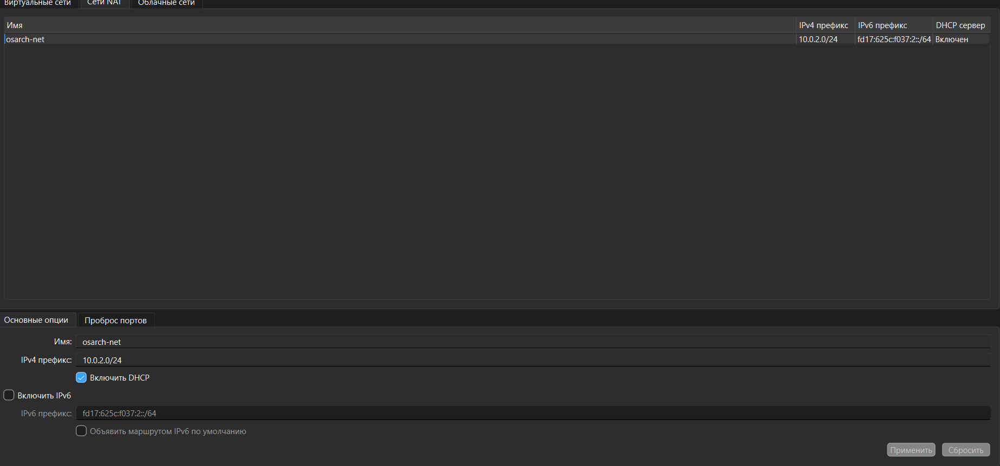
   **Check:** `osarch-net` is in the list.

**Why NAT Network and not another mode:** the two machines must see each other *and* the internet, without sitting on the real office network. NAT alone lets each machine out but hides them from each other. Bridged gives each machine its own address on the real network; networks that filter by MAC address (like the Innotech teaching network) will not accept it. Host-only has no internet. NAT Network is the only mode that does everything. If you build this at home and need to reach the machine from another computer, Bridged is the alternative.

---

## Part D. Ubuntu Server machine

### D1. Create it
1. Click **New**.
2. Name: `test-dev-vm`. ISO Image: choose the Ubuntu file.
3. **Unattended Installation: Make sure this box is unchecked.**
   **Why:** otherwise VirtualBox installs Ubuntu by itself with its own settings. Doing it by hand, you choose the user and see what happens. (If your wizard shows the box already ticked, leave it.)
   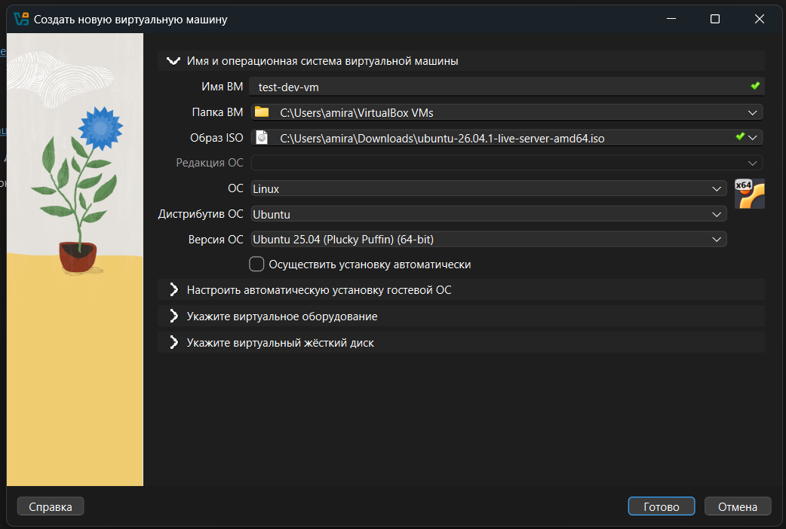
4. Hardware: Base Memory `2048 MB`, Processors `2`.
   **Why:** 2 GB is enough for Ubuntu Server and leaves the laptop fast.
   
5. Hard Disk: **Create a Virtual Hard Disk Now**, `25 GB`, leave **Pre-allocate Full Size unchecked**.
   **Why:** the file only grows as data is written, instead of taking 25 GB at once.
   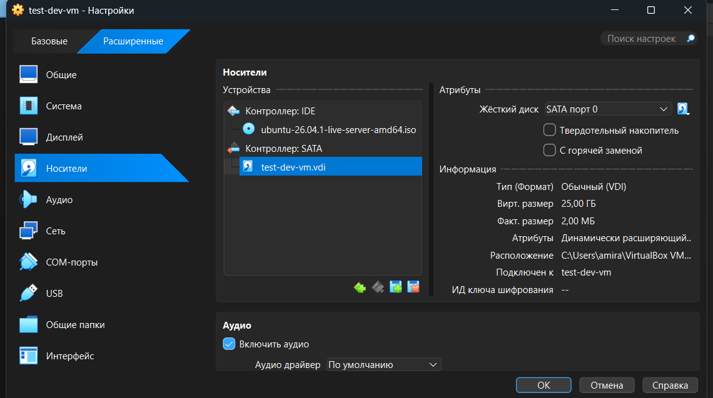
6. Click **Finish**. **Check:** `test-dev-vm` appears in the left list.

### D2. Connect it to the network
1. Select `test-dev-vm` → **Settings → Network → Adapter 1**.
2. Attached to: **NAT Network**; Name: `osarch-net` → **OK**.
   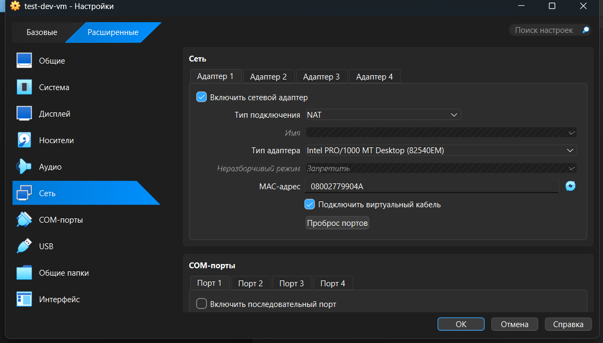

### D3. Install Ubuntu
1. Select `test-dev-vm`, click **Start**.
2. Choose **Try or Install Ubuntu Server**, then your language and keyboard.
3. On the network screen look for an address starting `10.0.2.`
   **Check:** an address is shown. If not, go back to D2.
4. Choose **Ubuntu Server** (not minimized), keep the default storage (use an entire disk).
5. Enter a name, a server name, a username and a password. Write them down.
6. Skip the optional extras (just press Done) and wait.
7. When it says "Please remove the installation medium, then press ENTER", press **Enter**.
   If it starts the installer again: menu **Devices → Optical Drives → Remove disk from virtual drive**, then Enter.
   **Why:** the install disc left in the drive makes the machine install itself again.
8. Log in with your username and password.
   **Check:** a prompt like `name@server:~$`.
   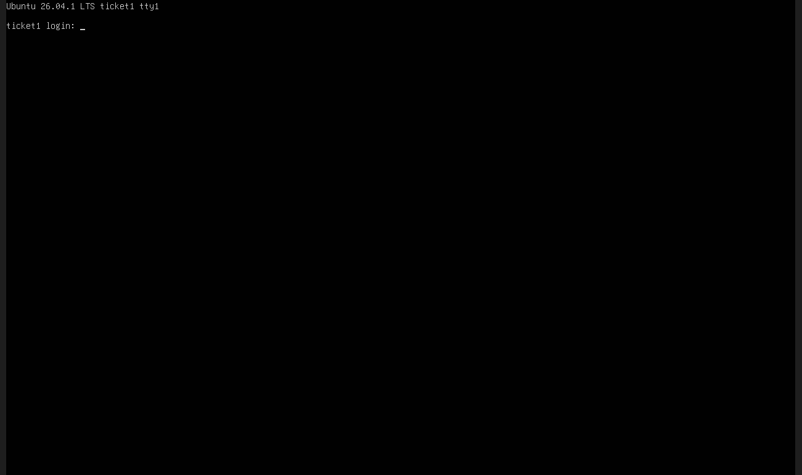

**If your mouse is stuck inside the machine:** press **Right Ctrl** (the "host key", shown in the bottom-right corner of the window). Ctrl+Alt+Delete does not release it.

### D4. Look inside
Ubuntu Server has no desktop and no Ctrl+Alt+T; the black screen after login *is* the terminal.
1. Type each command and press Enter. To save the output into a file at the same time:
   ```bash
   { echo '$ uname -a'; uname -a; echo; echo '$ lsb_release -a'; lsb_release -a; echo; echo '$ ip -br a'; ip -br a; } | tee ~/04-guest-uname.txt
   ```
   **Check:** a line `Linux … x86_64 GNU/Linux`, `Ubuntu 24.04…`, and an address `10.0.2.x`. Write the address down: [UBUNTU_IP].
   The file is saved as `evidence/04-guest-uname.txt` (see "Getting files out" below).
2. Check the disk is fully used:
   ```bash
   df -h /
   ```
   If it shows much less than about 24 GB, Ubuntu is using only part of the disk. Fix:
   ```bash
   sudo lvextend -r -l +100%FREE /dev/ubuntu-vg/ubuntu-lv
   ```
   **Why `-r`:** it also resizes the file system; without it the size does not change.

### Getting files out of the Ubuntu machine
Copying from the black window is hard. Easiest: open it in an ordinary window with SSH.
1. In the Ubuntu machine: `sudo apt install -y openssh-server`
2. VirtualBox → Tools → Network → NAT Networks → `osarch-net` → **Port Forwarding** → add: Name `ssh`, Protocol `TCP`, Host IP `127.0.0.1`, Host Port `2222`, Guest IP `[UBUNTU_IP]`, Guest Port `22`.
3. On the laptop, in PowerShell: `ssh -p 2222 yourusername@127.0.0.1`. Now you can select, copy and paste normally.

---

## Part E. Windows 11 machine

### E1. Create it
1. Click **New**. Name: `win11-eval`. ISO Image: the Windows file. Type **Microsoft Windows**, Version **Windows 11 (64-bit)**.
2. **Tick "Skip Unattended Installation".**
3. Hardware: Base Memory `4096 MB`, Processors `2`, tick **Enable EFI**.
4. Hard Disk: `64 GB`, Pre-allocate unchecked → **Finish**.
5. Select `win11-eval` → **Settings → System → Motherboard**: check that **EFI** is enabled, set **TPM** to `v2.0`, tick **Enable Secure Boot**.
   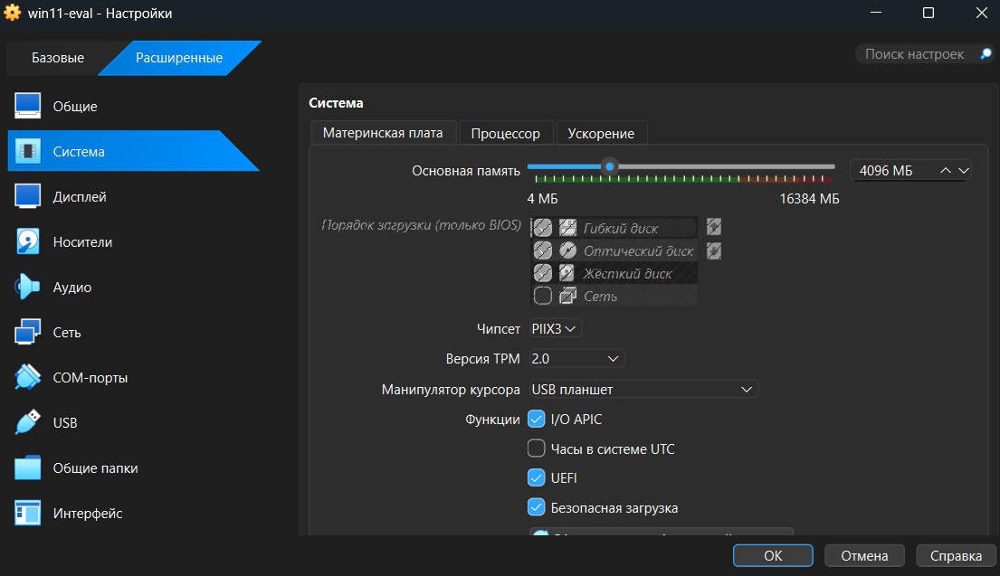
   **Why:** Windows 11 will not install without EFI, a TPM chip and Secure Boot; VirtualBox provides a virtual TPM.
6. **Settings → Display**: Video Memory `128 MB`.
7. **Settings → Network → Adapter 1**: **NAT Network**, `osarch-net` → **OK**.
   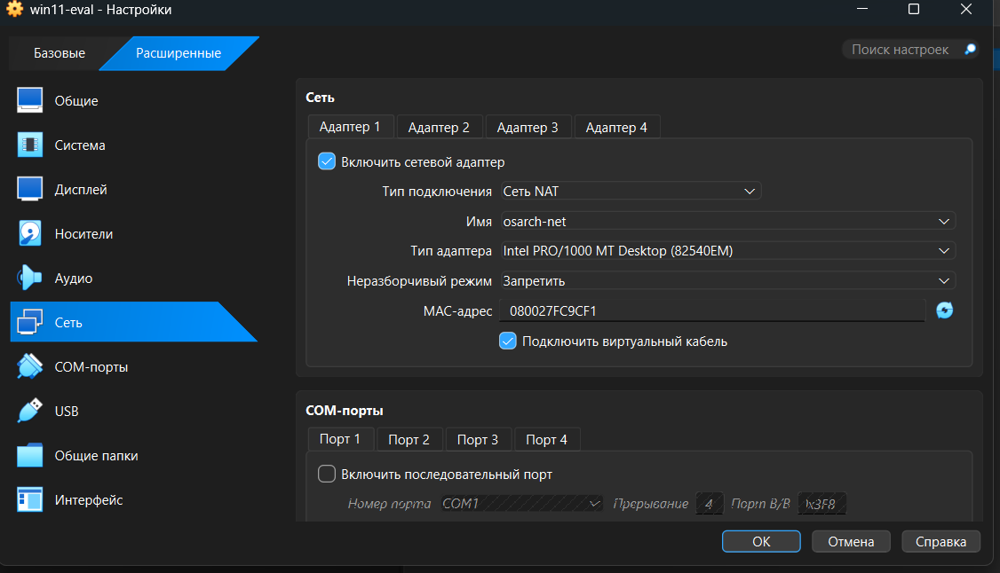

### E2. Install Windows
1. Click **Start**. When it shows "Press any key to boot from CD or DVD", press a key **immediately** (if you miss it, restart the machine).
2. Choose language and keyboard → **Install now**.
3. Click **I don't have a product key**.
4. Choose **Windows 11 Enterprise** → accept the licence.
5. Choose **Custom: Install Windows only** and select the 64 GB disk → Next. The machine restarts several times; wait.
6. If it insists on a Microsoft account or internet: press **Shift+F10**, type `OOBE\BYPASSNRO` and Enter. After the restart choose **I don't have internet → Continue with limited setup**, and create a local user.
7. After you reach the desktop, in the VirtualBox window menu choose **Devices → Insert Guest Additions CD image**, open the CD in File Explorer, run `VBoxWindowsAdditions.exe`, restart.
   **Why:** it fixes screen size and mouse integration.
   
8. Menu **Devices → Shared Clipboard → Bidirectional** so you can copy text between laptop and machine.

**Check the security chip:** press Win+R, type `tpm.msc`, Enter → "The TPM is ready for use", Version 2.0. Then Win+R, `msinfo32` → **Secure Boot State: On**, **BIOS Mode: UEFI**.
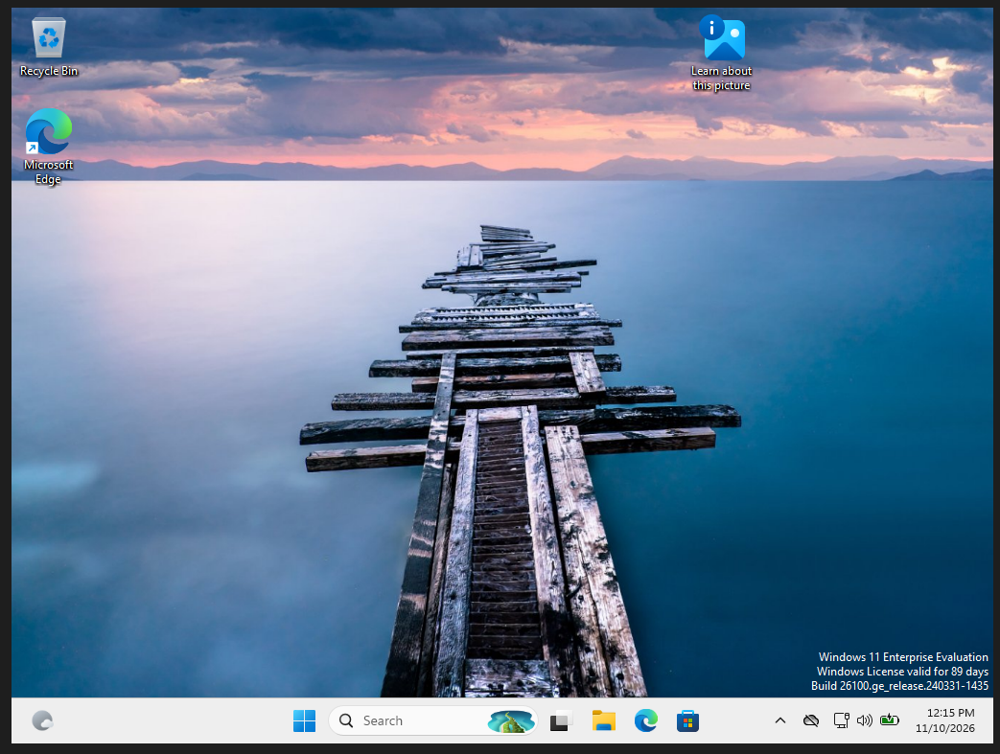

**Allow ping into Windows** (Windows blocks it by default, and we need it for the next part): click Start, type `PowerShell`, right-click → **Run as administrator**, run:
```powershell
netsh advfirewall firewall add rule name="Allow ICMPv4 In (lab)" protocol=icmpv4:8,any dir=in action=allow
```
**Check:** it prints `Ok.`

---

## Part F. Check that the two machines are on one network

Start both machines. Find the addresses: Ubuntu `ip -br a` → [UBUNTU_IP]; Windows open Command Prompt, `ipconfig` → IPv4 Address [WIN_IP]. Both start with `10.0.2.`
Save everything below into **one** file, unedited: `evidence/05-ping-between-guests.txt`.

1. On Ubuntu: `ping -c 4 [WIN_IP]` → **Check:** `0% packet loss`.
2. On Windows: `ping [UBUNTU_IP]` → **Check:** `Lost = 0 (0% loss)`.
3. On Ubuntu: `ping -c 4 8.8.8.8` → internet check.
4. On Windows: `ping 8.8.8.8` → internet check. Also open a website in the browser.

Save the command and its output each time (Ubuntu: `| tee -a ~/05.txt`; Windows: select text in the window and press Enter to copy, then paste into Notepad). Put the four blocks in one file with the command line above each block.

**Why 8.8.8.8:** it is Google's public address. Pinging a number, not a name, tests the connection without involving name lookup; if this works but websites do not, the problem is DNS, not the network.

---

## Part G. Save a clean state and test going back

1. Shut the machines down properly: Ubuntu `sudo poweroff` (the password does not show while typing, that is normal); Windows **Start → Power → Shut down**.
   **Check:** both show **Powered Off** in VirtualBox.
   **Why:** a snapshot of a machine that is off is the safest.
2. Select `test-dev-vm`, open the **Snapshots** tab (top right), click **Take**, name it `clean-base`, **OK**.
3. Do the same for `win11-eval`.
   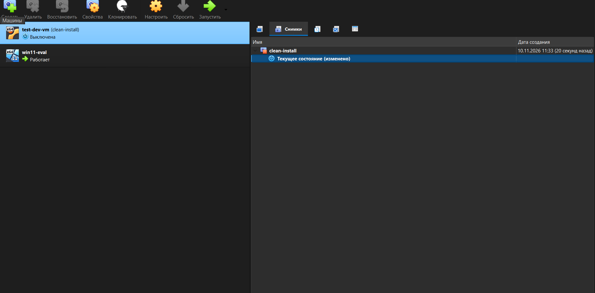
   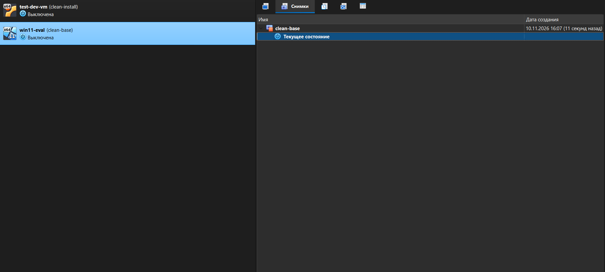
   **Check:** `clean-base` appears above "Current State".

### Test the way back (so you know it works)
1. Windows: start it, create a file `rollback-test.txt` on the desktop, shut down. In Snapshots, right-click `clean-base` → **Restore**. Start it.
   **Check:** the file is gone.
2. Ubuntu: start it, run `sudo mv /etc/netplan/*.yaml /root/ && sudo reboot`. After the restart `ip -br a` shows no address. Shut down, right-click `clean-base` → **Restore**, start it. **Check:** the address `10.0.2.x` is back.

**Never delete a machine while it is running, and never restore while it is running.** Always shut down first.

---

## Part H. If something goes wrong

| What you see | What to do |
|---|---|
| The machine does not start / "VT-x is not available" | Part A: turn on virtualization in BIOS. If Hyper-V is on in Windows, try turning off "Windows Hypervisor Platform" |
| Windows setup says "This PC can't run Windows 11" | Turn the machine off, check Part E step 5 (EFI, TPM v2.0, Secure Boot) |
| Black screen in Windows after install | Settings → Display → Graphics Controller: switch between VBoxSVGA and VMSVGA |
| Ubuntu installer shows no network address | Settings → Network: adapter must be NAT Network `osarch-net` |
| Ping to Windows times out | Windows Firewall: run the rule from Part E |
| The mouse is stuck inside the machine | Press Right Ctrl |
| The installer starts again after restart | Devices → Optical Drives → Remove disk from virtual drive |
| Windows asks for a key after 90 days | The evaluation expired: build a new one from the ISO |

---

## Part I. Why these choices

| Choice | Alternatives | Why this one |
|---|---|---|
| VirtualBox 7 | VMware Workstation Pro (free for personal use, needs account and its own licence terms); Hyper-V (built into Windows Pro/Enterprise, not Home, conflicts with other hypervisors); KVM/QEMU (Linux host only, hardest to learn) | Free for office use without the Extension Pack, same on every OS, supports TPM 2.0 |
| NAT Network | NAT, Bridged, Host-only (Part C) | The only one with guest ↔ guest and internet and no exposure to the real network |
| Dynamic disks | Fixed (pre-allocated) | Fixed is a little faster but would take 89 GB immediately; dynamic grows as needed. Risk: it can fill the laptop's disk, hence the 89 GB check |
| Evaluation Windows | Licensed Windows | Free, no key to buy by mistake; limited to 90 days |

---

## Appendix. List of screenshots

| File | Shows | Step |
|---|---|---|
| `screenshots/s01-virtualization.png` | Task Manager → CPU, "Virtualization: Enabled" | A2 |
| `screenshots/s05-nat-network.png` | NAT Network `osarch-net` in the list | C2 |
| `evidence/01-new-vm-wizard.png` | New-VM wizard for Ubuntu | D1 |
| `screenshots/s06-ubuntu-hardware.png` | Ubuntu: 2048 MB RAM, 2 processors | D1 |
| `evidence/02-disk-settings.png` | Ubuntu disk 25 GB, dynamically allocated | D1 |
| `evidence/03-network-adapter.png` | Ubuntu adapter: NAT Network `osarch-net` | D2 |
| `screenshots/s08-ubuntu-login.png` | Ubuntu prompt after login | D3 |
| `screenshots/s10-windows-tpm.png` | Windows → Motherboard: EFI, TPM v2.0, Secure Boot | E1 |
| `screenshots/s11-windows-network.png` | Windows adapter: NAT Network `osarch-net` | E1 |
| `screenshots/s13-windows-desktop.png` | Windows desktop after install | E2 |
| `screenshots/s14-windows-tpm-secureboot.png` | `tpm.msc` and `msinfo32` results | E2 |
| `evidence/06-snapshot-list.png` | Ubuntu snapshot `clean-base` | G |
| `screenshots/s15-windows-snapshot.png` | Windows snapshot `clean-base` | G |

The two text files `evidence/04-guest-uname.txt` and `evidence/05-ping-between-guests.txt` are produced in steps D4 and F.
